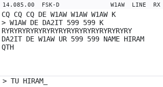
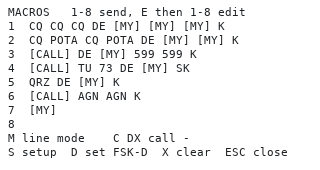

# ZeroRTTY

RTTY keyboard terminal for the Elecraft KX2 on the M5Stack CardputerZero.

The KX2 does the RTTY itself (FSK D mode: 45 baud, 170 Hz shift). ZeroRTTY is the
keyboard and the screen: what you type goes to the radio's own encoder over the
KXUSB cable, and what the radio decodes is shown on the display. No audio
connection and no sound card are involved.

 

**Status: 0.1.0, not yet run on a real CardputerZero or against a real KX2.**
It is built and tested on x86 against a simulated radio (see
[What has been tested](#what-has-been-tested)). The serial settings and the
`FA;` / `TB;` replies were confirmed on a real KX2 by hand.

## What you need

- Elecraft KX2 (the KX3 uses the same commands)
- KXUSB cable from the radio's ACC jack to the CardputerZero's USB port
- CardputerZero with the stock OS image

## Radio setup

1. `MENU:RS232` on the KX2: note the baud rate (ZeroRTTY defaults to 38400).
2. Select DATA mode, sub-mode **FSK D** — or let the app do it: `TAB`, then `D`.
3. Hold `TEXT` to switch on text decode, otherwise nothing is received.

The app also works in **PSK D** and **CW**: the radio turns the same text into
PSK31 or Morse.

## Keys

| Key | Action |
| --- | --- |
| type, `ENTER` | Line mode: send the line, then return to receive. Immediate mode: end the over. |
| `Backspace` | Correct the line before it is sent (line mode) |
| `TAB` | Menu: macros, DX call, setup |
| `Fn`+`1`..`8` | Send macro 1-8 |
| `Fn`+`9` | Set the DX call (fills `[CALL]` in macros) |
| `Fn`+`0` | Switch between line mode and immediate mode |
| `ESC` | Stop the transmission at once. Hold: exit |
| `Fn`+`F` / `Fn`+`X` | Scroll back / forward |
| `Fn`+`H` | Help |
| `Fn`+`J` | Screenshot |

**Line mode** (default): nothing goes on the air until `ENTER`, so typos can be
fixed. **Immediate mode**: each key is sent as you type it; `ENTER` ends the over.
If you just stop typing, the radio drops back to receive by itself after about
four seconds.

The status bar shows frequency and mode, the DX call, `LINE`/`IMM` and `RX`/`TX`
with the number of characters still waiting. It turns red while transmitting and
orange when something is wrong (no port, no reply from the radio, radio in a mode
that does not transmit text).

Sent text appears in the scrollback on lines starting with `>`.

### Menu (`TAB`)

- `1`..`8` sends that macro, `E` then `1`..`8` edits it
- `M` line / immediate mode
- `C` DX call
- `S` setup: my call, serial port, baud rate, text size, light / dark
- `D` sets the KX2 to DATA / FSK D
- `X` clears the screen

### Macros

`[MY]` is replaced by your call, `[CALL]` by the DX call. A macro with `[CALL]`
is not sent until a DX call is set. Defaults:

```
1  CQ CQ CQ DE [MY] [MY] [MY] K
2  CQ POTA CQ POTA DE [MY] [MY] K
3  [CALL] DE [MY] 599 599 K
4  [CALL] TU 73 DE [MY] SK
5  QRZ DE [MY] K
6  [CALL] AGN AGN K
7  [MY]
8  (empty)
```

### What can be sent

Letters (sent as capitals), digits, space and `. , ? / -`. Everything else is
refused when typed and dropped from macros. More punctuation can be allowed with
`extra_tx_characters` in the configuration; `; < > @` are never sent because the
radio treats them as commands.

## Build and install on the CardputerZero

```sh
sudo apt install -y build-essential cmake ninja-build git \
  libfreetype-dev libpng-dev libjpeg-dev libfmt-dev zlib1g-dev
# optional, for a fixed-width terminal font (the package name depends on the release)
sudo apt install -y fonts-dejavu-mono || sudo apt install -y fonts-dejavu-core

git clone https://github.com/Purple-Tentacle/ZeroRTTY.git
cd ZeroRTTY
cmake --preset cp0-native -DCM0_SDK_ROOT=/
cmake --build --preset cp0-native-rel -j2     # first build compiles LVGL: slow
```

CMake 3.31 or newer is required. The first configure downloads LVGL, so the
device needs internet access once.

Check the radio link before starting the UI:

```sh
./build/cp0-native/Release/zerortty_cli status        # frequency, mode, RX/TX
./build/cp0-native/Release/zerortty_cli monitor 30    # decoded text for 30 s
./build/cp0-native/Release/zerortty_cli send "TEST DE DA2IT"   # transmits!
```

Install into the launcher:

```sh
(cd build/cp0-native && cpack -C Release -G DEB)
sudo apt install ./dist/ZeroRTTY_0.1.0_rev1_arm64.deb
```

If the status bar says `No port /dev/ttyUSB0: Permission denied`, the user the
launcher runs apps as may not open the serial port. `/dev/ttyUSB0` belongs to
group `plugdev`: `sudo usermod -aG plugdev <user>`, then log in again.

## Configuration

`/etc/zerortty.conf` holds the defaults. Changes made in the app are written to
`~/.config/zerortty/zerortty.conf`, which takes precedence.

```ini
[application]
dark_mode=no
small_font=no
line_mode=yes

[station]
my_call=DA2IT

[radio]
device=/dev/ttyUSB0
baud=38400
extra_tx_characters=

[macros]
1=CQ CQ CQ DE [MY] [MY] [MY] K
```

## Testing without a radio

`zerortty_kx2sim` is a pretend KX2 on a pseudo terminal. It answers the commands
ZeroRTTY uses, "receives" a line of RTTY every few seconds and prints what it is
asked to transmit.

Desktop preview (Linux, needs `libsdl2-dev`):

```sh
cmake --preset linux-x86-64 && cmake --build --preset linux-x86-64-rel
./build/linux-x86-64/Release/zerortty_kx2sim &        # prints e.g. /dev/pts/3
ZERORTTY_PORT=/dev/pts/3 ./build/linux-x86-64/Release/zerortty
```

The tests need no hardware:

```sh
./build/linux-x86-64/Release/zerortty_test
```

Environment variables: `ZERORTTY_PORT` overrides the serial port,
`ZERORTTY_CONFIG` the settings file. `ZERORTTY_TEST_KEYS` and
`ZERORTTY_SCREENSHOT_AFTER` script the UI (see `src/app/app.cpp`).

## How it talks to the radio

| Command | Use |
| --- | --- |
| `KY text;` | Send text through the radio's CW-to-DATA encoder, at most 24 characters per command |
| `KY` + EOT (0x04) | End the over in FSK D / PSK D without the radio's 4 s idle tail |
| `TB;` | Poll decoded receive text and the number of characters the radio still has to send |
| `TQ;` `FA;` `MD;` `DT;` | Transmit state, frequency, mode, data sub-mode |
| `RX;` | Stop transmitting now (`ESC`) |
| `MD6;DT2;` | Select DATA / FSK D |

Text is fed in chunks of ten characters, and only when the radio reports four or
fewer still waiting, so its buffer cannot overflow. Text is refused while the
radio does not answer or is in a voice mode, and anything still queued is dropped
when the radio goes away — nothing is transmitted later by surprise.

## What has been tested

On x86, against the simulated KX2 (`zerortty_test`, 156 checks): the reply
parser, the transmit flow control at 6 and 60 characters per second, receive
text, stopping a transmission, a missing port, a silent radio, wrong mode, the
terminal behaviour (line and immediate mode, macros, editing, setup) and the
settings file. The UI was checked with scripted screenshots in the desktop
build, and the CardputerZero configuration compiles and packages.

Not tested, because it needs the hardware:

- the device keyboard (key codes for `Fn`, `Sym` and `Shift` combinations);
  unknown key codes are logged as `unmapped key code N`
- display, fonts and layout on the real screen
- everything against a real KX2: how FSK D treats the punctuation marks, whether
  the radio reports its own transmitted text back as received text, and the
  timing of the end-of-over marker

## Credits

Built from the [CardputerZero Template](https://github.com/CardputerZero/Template)
(LVGL 9.5). KX2 commands from Elecraft's K3S/K3/KX3/KX2 Programmer's Reference.
MIT licence.
